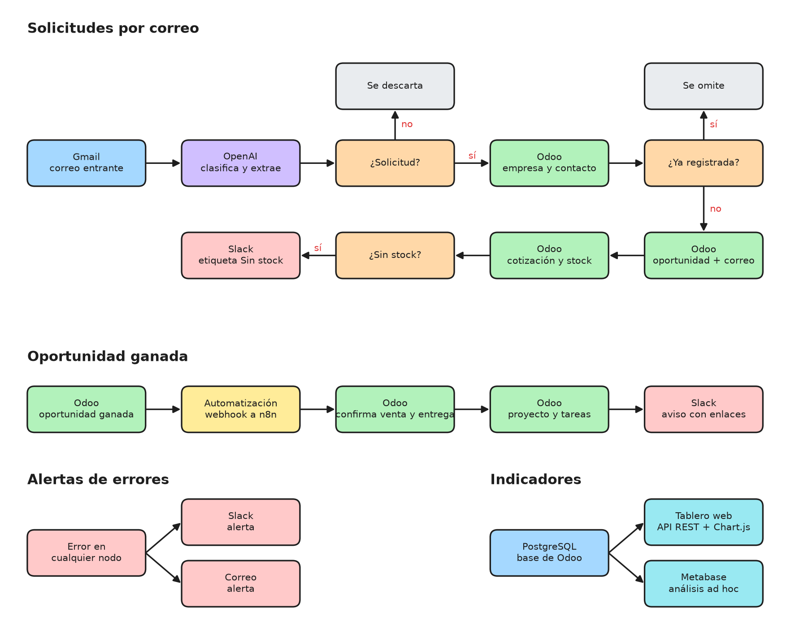
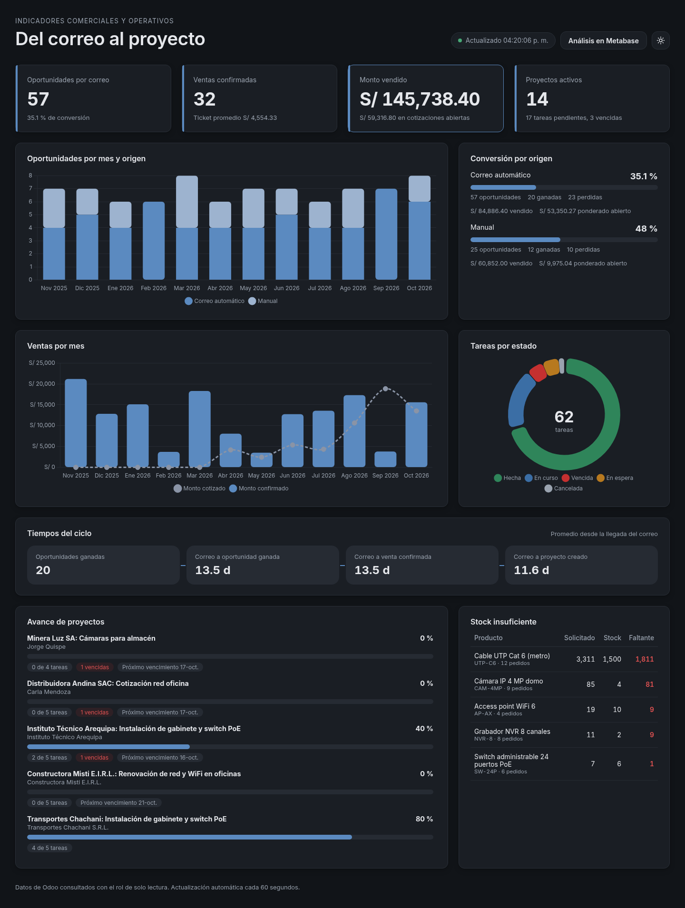
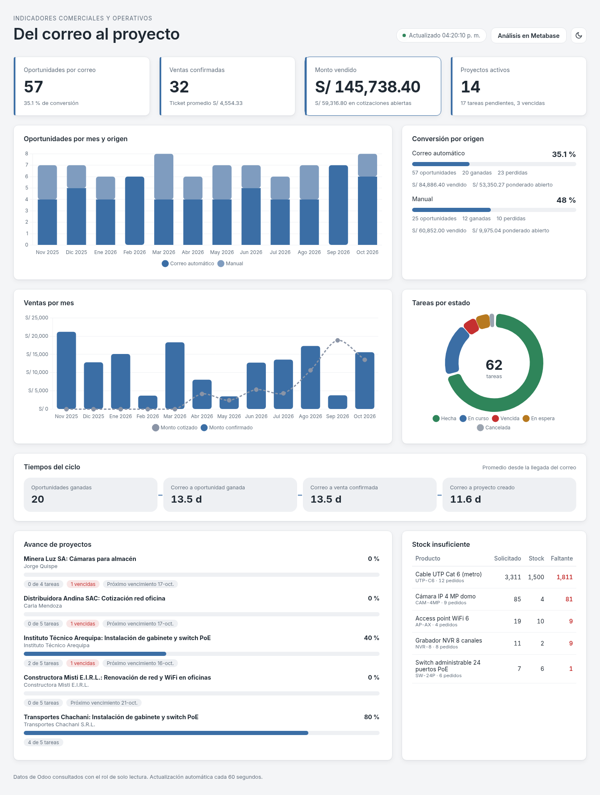
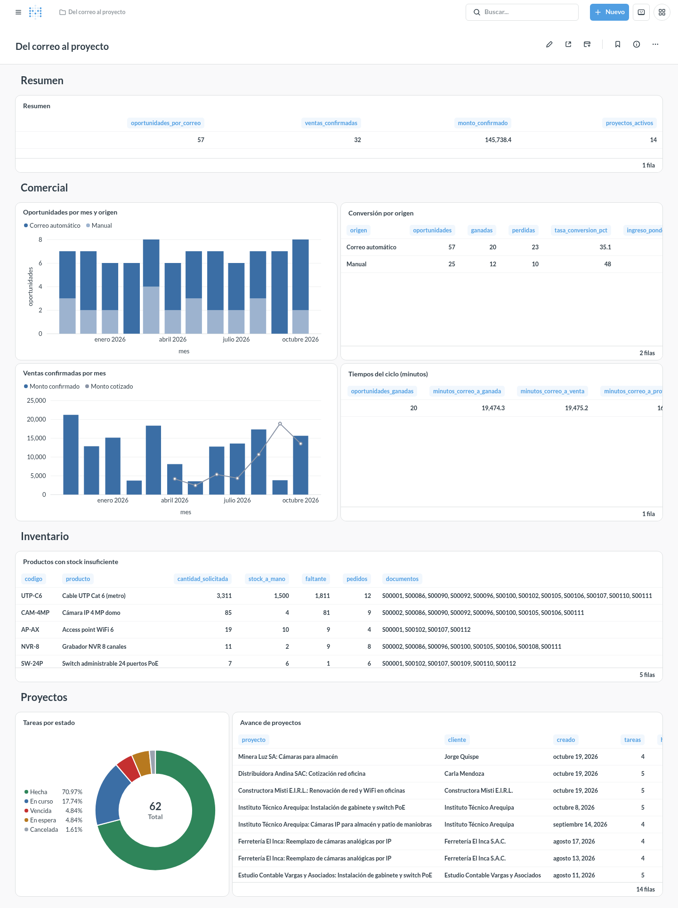

# Del correo al proyecto

Gestión comercial en Odoo 18 desde el primer correo del cliente hasta el proyecto en ejecución. Un flujo de automatización en n8n lee las solicitudes que llegan a Gmail, una API de IA (OpenAI) se encarga de la clasificación y extracción de datos, y Odoo registra la oportunidad, la cotización y, al ganarse, el proyecto con sus tareas. Los indicadores comerciales y operativos salen de consultas SQL directas a PostgreSQL y se publican en dos partes complementarias: Metabase, para el análisis y los reportes de autoservicio, y un tablero web propio, como pantalla operativa.



Diagrama editable: [docs/arquitectura.excalidraw](docs/arquitectura.excalidraw), se abre en https://excalidraw.com.

## Qué hace

### Solicitudes por correo

1. Revisa la bandeja de Gmail cada minuto.
2. El nodo HTTP Request llama a la API de OpenAI (Chat Completions, modelo gpt-4o-mini), que clasifica cada correo como solicitud, consulta u otro, y de las solicitudes extrae empresa, RUC, contacto, correo, teléfono, necesidad, tipo de servicio, productos con cantidades, urgencia, fecha deseada y un resumen. La clasificación usa los tipos de servicio y el catálogo de productos vigentes en Odoo.
3. Omite el correo si ya generó una oportunidad.
4. Se conecta a Odoo por JSON-RPC sobre HTTP con la clave de API del usuario, busca la empresa por RUC o nombre y el contacto por correo; crea los que no existan.
5. Crea la oportunidad con origen Correo automático, urgencia, prioridad, tipo de servicio, fecha deseada y resumen, y deja el correo original en el historial como nota.
6. Crea la cotización en borrador vinculada a la oportunidad con los productos encontrados. Los productos que no están registrados se agregan como nota en la cotización.
7. Compara las cantidades pedidas con el stock disponible. Si falta stock o algún producto no está registrado, etiqueta la oportunidad como Sin stock y avisa en Slack con el detalle.

### Oportunidad ganada

1. Al marcar una oportunidad como ganada, una automatización interna de Odoo envía la oportunidad al webhook de n8n.
2. n8n confirma la cotización vinculada, con lo que Odoo reserva el stock y genera la orden de entrega.
3. Crea el proyecto del cliente con las tareas de la plantilla del tipo de servicio, cada una con su responsable y fecha límite (los plazos que caen en fin de semana pasan al lunes).
4. Vincula el proyecto a la oportunidad y avisa en Slack con los enlaces al proyecto y a la oportunidad.

Una oportunidad que ya tiene proyecto no genera otro si se vuelve a marcar como ganada.

### Alertas de errores

Ante cualquier error en los flujos, envía una alerta por Slack y por correo con el flujo, el nodo, el mensaje y el enlace a la ejecución.

### En Odoo

El módulo `correo_proyecto` configura y personaliza CRM, Ventas, Inventario y Proyectos:

- Pestaña Solicitud en las oportunidades: origen, tipo de servicio, urgencia, fecha deseada, resumen y productos solicitados, con acceso directo al proyecto.
- Columnas Tipo de servicio y Urgencia en la lista de oportunidades, filtros Desde correo, Urgentes y Sin stock, y agrupación por tipo de servicio y urgencia.
- CRM > Configuración > Tipos de servicio: plantillas de tareas por tipo de servicio, con plazo en días y responsable.
- Datos iniciales: los tipos de servicio Instalación de red y Videovigilancia con sus tareas, y seis productos de redes y videovigilancia con stock.

## Requisitos

- Docker y Docker Compose.
- Python 3 para los scripts de configuración de Metabase y de datos de ejemplo (solo usan la biblioteca estándar).
- Clave de API de OpenAI.
- Cuenta de Google con acceso al buzón comercial y credenciales OAuth2 de Google Cloud con la API de Gmail habilitada.
- Aplicación de Slack con un token de bot (`xoxb-`) con el permiso `chat:write`, invitada al canal de avisos.

## Instalación

1. Copiar el archivo de variables y completar los valores:

   ```bash
   cp .env.example .env
   ```

   | Variable | Descripción |
   | --- | --- |
   | `TZ` | Zona horaria de n8n |
   | `POSTGRES_PASSWORD` | Contraseña de PostgreSQL |
   | `ODOO_PUBLIC_URL` | URL de Odoo usada en los enlaces de los avisos |
   | `ODOO_DB` | Nombre de la base de datos de Odoo |
   | `ODOO_USER` | Usuario de Odoo que registra las operaciones |
   | `ODOO_API_KEY` | Clave de API de ese usuario |
   | `SLACK_CANAL` | Canal de Slack para avisos y alertas |
   | `ALERTAS_CORREO` | Correo que recibe las alertas de error |
   | `MB_URL` | Dirección de Metabase usada por el script de configuración |
   | `MB_ADMIN_NOMBRE`, `MB_ADMIN_EMAIL`, `MB_ADMIN_PASSWORD` | Administrador de Metabase |
   | `MB_EMPRESA` | Nombre de la organización en Metabase |
   | `LECTOR_HOST` | Servidor PostgreSQL al que se conecta Metabase |
   | `LECTOR_PASSWORD` | Contraseña del rol de solo lectura `lector` |

2. Levantar los servicios:

   ```bash
   docker compose up -d
   ```

3. Crear la base de datos en http://localhost:8069 con el nombre definido en `ODOO_DB`, país Perú y el correo definido en `ODOO_USER`.

4. En Aplicaciones, quitar el filtro Aplicaciones, buscar el módulo **Del correo al proyecto** e instalarlo. Instala también CRM, Ventas, Inventario y Proyecto, deja la moneda de la compañía en PEN y carga el stock inicial de los productos.

5. Crear la clave de API: menú de usuario > Preferencias > Seguridad de la cuenta > Nueva clave de API. Copiarla en `ODOO_API_KEY` dentro de `.env` y aplicar el cambio:

   ```bash
   docker compose up -d
   ```

6. Importar los flujos en n8n:

   ```bash
   docker compose exec n8n n8n import:workflow --separate --input=/workflows
   ```

7. Abrir n8n en http://localhost:5678, crear la cuenta de propietario y registrar las credenciales:

   | Credencial | Tipo en n8n | Nodos |
   | --- | --- | --- |
   | OpenAI | OpenAI API | Analizar correo (OpenAI) |
   | Gmail | Gmail OAuth2 API | Correo entrante, Gmail (Alertas de errores) |
   | Slack | Slack API, token de acceso `xoxb-` con `chat:write` | Avisar en Slack (ambos flujos), Slack (Alertas de errores) |

8. Asignar cada credencial a sus nodos, guardar y activar los flujos **Solicitudes por correo**, **Oportunidad ganada → proyecto** y **Alertas de errores**.

9. Opcional: cargar datos de ejemplo para revisar los indicadores con historial. El script `scripts/datos_ejemplo.py` crea por JSON-RPC, con la clave de API de `.env`, 25 empresas peruanas con su contacto, 80 oportunidades de los últimos 12 meses (la mayoría con origen Correo automático, el resto manuales) en todas las etapas, ganadas y perdidas, unas 50 cotizaciones y ventas con sus entregas, productos con stock insuficiente y 12 proyectos creados con las plantillas de tareas, con tareas hechas, en curso, en espera, canceladas y vencidas.

   ```bash
   set -a; . ./.env; set +a
   python3 scripts/datos_ejemplo.py
   ```

   Odoo no permite fijar por API la fecha de creación de los registros, así que al terminar el script ajusta en PostgreSQL las fechas de creación, cierre y pedido para distribuirlas en el año; usa `docker compose exec -T db psql`, que puede reemplazarse con la variable `DATOS_PSQL`. Con `--sin-fechas` se omite ese paso y todos los registros quedan con la fecha del día. Durante la carga se desactiva la automatización de oportunidades ganadas para que n8n no cree proyectos duplicados, y se vuelve a activar al terminar.

   El script se puede ejecutar varias veces: si los datos ya existen no vuelve a crearlos. Los registros se identifican por la referencia `EJ-` de las empresas y se eliminan con `python3 scripts/datos_ejemplo.py --eliminar`.

Odoo envía las oportunidades ganadas a `http://n8n:5678/webhook/oportunidad-ganada`. Si n8n está en otra dirección, cambiar el parámetro `correo_proyecto.webhook_url` en Ajustes > Técnico > Parámetros del sistema (requiere el modo desarrollador).

## Indicadores

Los indicadores salen de las consultas SQL de `sql/`, que se ejecutan sobre la base de Odoo con el rol `lector`, que solo tiene permiso de consulta sobre las tablas usadas. Las mismas consultas alimentan dos partes con funciones distintas:

- **Metabase**, para el análisis y los reportes de autoservicio: el equipo puede filtrar, cruzar datos, guardar preguntas propias y programar envíos de reportes sin depender de desarrollo.
- **Tablero web**, como pantalla operativa: una vista fija que se actualiza sola, pensada para seguir el día a día del área comercial y de proyectos.

Ambos usan la misma paleta sobria: un azul como color principal, grises neutros, y verde, ámbar y rojo solo para estados.

### Tablero web

El tablero web (http://localhost:8080) es la pantalla operativa. El servicio `tablero` es una API REST en Python (FastAPI y psycopg) que ejecuta las consultas de `sql/` en una transacción de solo lectura y entrega el resultado en JSON; la interfaz está hecha en HTML, CSS y JavaScript con Chart.js incluido en el repositorio, sin dependencias externas en el navegador. Se actualiza cada 60 segundos, muestra los montos en soles y tiene tema oscuro y claro.





| Ruta | Contenido |
| --- | --- |
| `GET /api/tablero` | Todos los indicadores en una sola respuesta |
| `GET /api/{indicador}` | Un indicador: `resumen`, `oportunidades-por-mes`, `conversion-por-origen`, `ventas-por-mes`, `stock-insuficiente`, `proyectos`, `tareas-por-estado`, `tiempos-ciclo` |
| `GET /api/salud` | Estado de la conexión a PostgreSQL |

Las consultas se montan en el contenedor como volumen, así que un cambio en `sql/` se refleja en el tablero sin reconstruir la imagen.

### Metabase

Metabase (http://localhost:3000) publica el tablero **Del correo al proyecto**, organizado en secciones (Resumen, Comercial, Inventario y Proyectos), y es la herramienta de análisis y reportes de autoservicio: filtrar, cruzar datos, crear consultas nuevas sobre la base de Odoo y programar reportes. Guarda su configuración en la base `metabase` del mismo PostgreSQL.

| Tarjeta | Consulta | Contenido |
| --- | --- | --- |
| Resumen | `sql/08_resumen.sql` | Oportunidades por correo, ventas confirmadas, monto vendido y proyectos activos |
| Oportunidades por mes y origen | `sql/01_oportunidades_por_mes.sql` | Oportunidades por mes, etapa y origen (Correo automático o Manual) |
| Conversión por origen | `sql/02_conversion_por_origen.sql` | Ganadas, perdidas, tasa de conversión, ingreso esperado ponderado y monto vendido |
| Ventas confirmadas por mes | `sql/03_ventas_por_mes.sql` | Cotizaciones abiertas, ventas confirmadas, montos y ticket promedio |
| Tiempos del ciclo | `sql/07_tiempos_ciclo.sql` | Minutos promedio desde el correo hasta la oportunidad ganada, la venta y el proyecto |
| Productos con stock insuficiente | `sql/04_stock_insuficiente.sql` | Productos cuya cantidad pendiente de entregar supera el stock en almacenes internos |
| Tareas por estado | `sql/06_tareas_por_estado.sql` | Tareas en curso, vencidas, hechas y canceladas |
| Avance de proyectos | `sql/05_proyectos_tareas.sql` | Tareas por proyecto, vencidas, próximo vencimiento y porcentaje de avance |



Configuración, una vez instalado el módulo en Odoo. El paso 1 también es necesario para el tablero web:

1. Crear el rol de solo lectura en la base de Odoo:

   ```bash
   set -a; . ./.env; set +a
   docker compose exec -T db psql -U odoo -d "$ODOO_DB" -v lector_password="'$LECTOR_PASSWORD'" < sql/00_lector.sql
   ```

2. Crear el administrador de Metabase, la conexión a Odoo, las tarjetas y el tablero:

   ```bash
   python3 scripts/metabase_setup.py
   ```

   El script espera a que Metabase esté disponible, valida que cada tarjeta devuelva datos y muestra la dirección del tablero. Puede ejecutarse de nuevo después de modificar las consultas de `sql/`: actualiza las tarjetas existentes sin duplicarlas.

La base `metabase` se crea con `sql/initdb/01_metabase.sql` al iniciar PostgreSQL por primera vez. Si el volumen de datos ya existía, crearla con:

```bash
docker compose exec db psql -U odoo -d postgres -c "CREATE DATABASE metabase"
docker compose restart metabase
```

## Uso

- Los correos de la bandeja de entrada, excepto promociones, redes sociales y los enviados por la propia cuenta, se procesan en el minuto siguiente a su llegada. Las nuevas oportunidades aparecen en CRM > Ventas > Mi flujo con el filtro Desde correo; las cotizaciones, en Ventas > Pedidos > Presupuestos.
- Al pulsar Ganado en una oportunidad, el pedido queda confirmado, la entrega aparece en Inventario y el proyecto en la aplicación Proyecto.
- Para agregar un tipo de servicio, crearlo en CRM > Configuración > Tipos de servicio con un código y sus tareas. El modelo lo considera desde el siguiente correo.

## Estructura

```
.
├── addons/
│   └── correo_proyecto/                 Módulo de Odoo
│       ├── __manifest__.py
│       ├── hooks.py                     Moneda PEN y stock inicial
│       ├── data/
│       │   ├── automation_data.xml      Automatización y webhook a n8n
│       │   ├── crm_data.xml             Etiqueta Sin stock y URL del webhook
│       │   ├── product_data.xml
│       │   └── service_type_data.xml    Tipos de servicio y tareas
│       ├── models/
│       │   ├── crm_lead.py
│       │   ├── ir_actions_server.py
│       │   └── service_type.py
│       ├── security/ir.model.access.csv
│       └── views/
│           ├── crm_lead_views.xml
│           └── service_type_views.xml
├── docs/
│   ├── arquitectura.excalidraw
│   ├── arquitectura.png
│   ├── tablero.png                      Metabase
│   ├── tablero-web.png
│   └── tablero-web-claro.png
├── scripts/
│   ├── datos_ejemplo.py                 Datos de ejemplo por JSON-RPC
│   └── metabase_setup.py                Tablero de Metabase por API
├── sql/
│   ├── initdb/01_metabase.sql           Base de datos de Metabase
│   ├── 00_lector.sql                    Rol de solo lectura
│   └── 01_ … 08_*.sql                   Consultas de los indicadores
├── tablero/                             Tablero web
│   ├── app.py                           API REST (FastAPI)
│   ├── Dockerfile
│   ├── requirements.txt
│   └── static/                          HTML, CSS, JavaScript y Chart.js
├── workflows/
│   ├── solicitudes-correo.json          Correo → oportunidad y cotización
│   ├── oportunidad-ganada.json          Venta confirmada y proyecto
│   └── alertas-errores.json             Alertas por Slack y correo
├── docker-compose.yml
└── .env.example
```

## Control de versiones

Los flujos se versionan con Git como archivos JSON en `workflows/`; la lógica de integración está en nodos Code (JavaScript) y el módulo de Odoo en Python. El entorno de Docker (Odoo, PostgreSQL, n8n, el tablero web y Metabase) permite probar los cambios en local. Después de modificar los flujos en n8n, exportarlos al repositorio:

```bash
docker compose exec n8n n8n export:workflow --all --separate --output=/workflows
```
